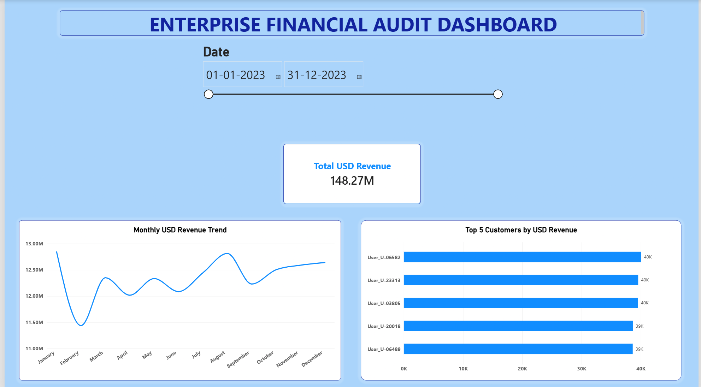

# Enterprise Financial Audit Dashboard

## Project Overview

This project demonstrates an end-to-end financial data reconciliation and audit analytics workflow using Python, SQL, and Power BI.

The project combines transaction logs, user records, and foreign exchange rates to clean and validate financial data, calculate revenue in USD, and present key business insights through an interactive dashboard.

## Business Problem

A FinTech company needs reliable financial reporting from multiple data sources. Raw transaction logs may contain errors, user records may have multiple entries, and exchange-rate data may have missing dates.

This project addresses these challenges by preparing, reconciling, and validating the data before analyzing revenue performance.

## Tools and Technologies

- **Python:** Pandas, NumPy, regular expressions, data cleaning, and transformation
- **SQL:** SQLite, window functions, and `ROW_NUMBER()`
- **Power BI:** Dashboard development, data modeling, DAX measures, and date filtering

## Project Workflow

1. **SQL data processing:** Used window functions to identify the latest record for each user and retain active users.
2. **Transaction log processing:** Used Python and regular expressions to extract transaction details from raw server logs.
3. **Data cleaning:** Filtered error logs and prepared valid transaction records.
4. **Currency conversion:** Forward-filled missing exchange-rate dates and calculated revenue in USD from EUR values.
5. **Data validation:** Checked duplicate records and missing values in key fields.
6. **Dashboard development:** Created a Power BI dashboard to analyze revenue trends and customer performance.

## Data Quality Results

| Metric | Result |
|---|---:|
| Raw server log records | 100,000 |
| Valid INFO transactions | 94,902 |
| ERROR logs filtered | 5,098 |
| Final reconciled records | 53,899 |
| Latest active users | 14,183 |
| Duplicate final records | 0 |

The final dataset was validated with no missing User IDs or USD Revenue values.

## Key Financial Findings

| Metric | Result |
|---|---:|
| Total USD revenue | $148.27 million |
| Highest monthly revenue | January — $12.84 million |
| Lowest monthly revenue | February — $11.44 million |
| Top customer revenue | $40.05K |

## Business Insights

- Monthly revenue remained relatively stable, with January recording the highest revenue and February the lowest.
- Customer-level analysis helps identify high-value customers.
- Date filtering supports analysis of revenue performance across different periods.
- Customer insights can help the business plan retention strategies for high-value customers.

## Dashboard Features

- Monthly revenue trend analysis
- Total USD revenue overview
- Top 5 customer analysis
- Date slicer for interactive filtering
- Revenue and customer performance insights

## Dashboard Preview

## Project Files

- [Power BI Dashboard](Enterprise_Financial_Audit_Dashboard.pbix) — Interactive financial audit dashboard
- [Python Notebook](Enterprise_Financial_Audit_Dashboard_Python.ipynb) — Data cleaning, transformation, and validation
- [Project Presentation](Enterprise_Financial_Audit_Dashboard_Presentation.pptx) — Project overview and findings

## Conclusion

This project demonstrates how Python, SQL, and Power BI can be combined to prepare financial data, improve data quality, reconcile transaction records, and analyze revenue performance. It highlights practical skills in data cleaning, SQL analysis, validation, dashboard development, and business reporting.

---

**Created by:** Manasa A

**Project Year:** 2026
